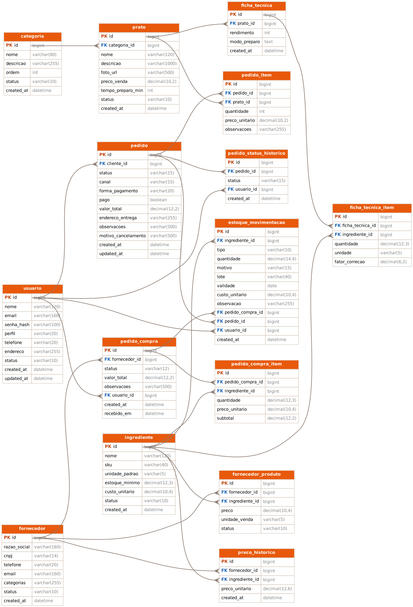

# 🔥 Comanda Digital

Sistema de pedidos para **Dark Kitchen**. O cliente monta o pedido pelo site e acompanha o preparo em tempo real. A cozinha recebe os pedidos, controla fichas técnicas, custos, estoque, fornecedores e compras.

Trabalho Final de Desenvolvimento Full-Stack, UNASP SP (ADS, 2026/2).

## 🌐 Sistema no ar

| Camada | URL |
|---|---|
| Front-end (Firebase Hosting) | `https://SEU-PROJETO.web.app` ← **troque pela sua URL** |
| Back-end (Render) | `https://SEU-BACKEND.onrender.com` ← **troque pela sua URL** |
| Swagger | `https://SEU-BACKEND.onrender.com/swagger-ui.html` |
| Banco | MySQL 8 gerenciado no Aiven |

> ⏳ O plano gratuito do Render "dorme" após 15 min sem uso. Abra a URL do back-end e aguarde ~1 minuto antes de usar ou gravar o vídeo.

### Usuários de teste (senha de todos: `senha123`)

| Perfil | Email | O que acessa |
|---|---|---|
| ADMIN | admin@email.com | Tudo |
| GERENTE | gerente@email.com | Pedidos, cardápio, estoque, fornecedores, compras, dashboard |
| COZINHEIRO | cozinheiro@email.com | Fila de pedidos (CONFIRMADO → EM_PREPARO → PRONTO) |
| CLIENTE | cliente@email.com | Cardápio, carrinho, checkout, meus pedidos |

## 🧱 Stack

| Camada | Tecnologia |
|---|---|
| Back-end | Java 21 · Spring Boot 3.5 · Spring Data JPA/Hibernate · Spring Security + JWT · Bean Validation · SpringDoc (Swagger) · Flyway |
| Front-end | Angular 22 (standalone + signals) · Angular Material · Reactive Forms · ng2-charts/Chart.js |
| Banco | MySQL 8 (migrations versionadas com Flyway) |
| Deploy | Render (back, Docker) · Firebase Hosting (front, plano Spark gratuito; Vercel continua opcional) · Aiven (MySQL) |

## 📁 Estrutura

```
comanda-digital/
├── backend/                         Spring Boot
│   ├── src/main/java/br/unasp/comanda/
│   │   ├── controller/              Endpoints REST (só recebem, chamam o service e respondem)
│   │   ├── service/                 Regras de negócio (RN01 a RN10), @Transactional
│   │   ├── repository/              Interfaces JPA e queries (dashboard, saldo...)
│   │   ├── model/ (+ enums/)        Classes @Entity
│   │   ├── dto/                     Records de request/response (nunca expomos a Entity)
│   │   ├── config/                  SecurityConfig, CorsConfig, OpenApiConfig
│   │   ├── security/                JwtService, filtro JWT, usuário logado
│   │   ├── exception/               @RestControllerAdvice + ApiError padronizado
│   │   └── validation/              @Cnpj (algoritmo oficial)
│   ├── src/main/resources/db/migration/
│   │   ├── V1__create_tables.sql    Tabelas, FKs e índices
│   │   └── V2__seed_data.sql        Usuários, 6 categorias, 23 ingredientes, 8 pratos com ficha, fornecedores, pedidos de exemplo
│   ├── src/test/                    Testes de integração com MySQL real
│   ├── Dockerfile
│   └── .env.example
├── frontend/                        Angular
│   └── src/app/
│       ├── core/                    Serviços (API, auth, carrinho), interceptors, guards, models
│       ├── shared/                  Diálogos e etiquetas reutilizáveis
│       ├── loja/                    Área do cliente
│       └── admin/                   Painel administrativo
├── docs/DER.png                     Diagrama entidade-relacionamento
├── docs/ROTEIRO_VIDEO.md            Roteiro do vídeo pitch de 5 minutos
├── .github/workflows/ci.yml         Compila e testa back e front a cada push
└── render.yaml                      Blueprint opcional do Render
```

## 🗺️ Banco de dados



O saldo de estoque **não** fica numa coluna: ele é sempre calculado pelas movimentações (`entradas + estornos − saídas`). Isso dá rastreabilidade total de cada grama de ingrediente.

---

## 💻 Como rodar localmente

**Pré-requisitos:** Java 21, Maven 3.9+ (ou IntelliJ), Node 22+, MySQL 8.

### 1. Banco

```sql
CREATE DATABASE comanda CHARACTER SET utf8mb4;
CREATE USER 'comanda'@'localhost' IDENTIFIED BY 'comanda';
GRANT ALL ON comanda.* TO 'comanda'@'localhost';
```

As tabelas e os dados de exemplo são criados automaticamente pelo Flyway quando o back sobe.

### 2. Back-end

```bash
cd backend
cp .env.example .env        # ajuste usuário/senha do MySQL e o JWT_SECRET
mvn spring-boot:run
```

- API: http://localhost:8080
- Swagger: http://localhost:8080/swagger-ui.html

O arquivo `.env` é lido automaticamente e está no `.gitignore` (segredos nunca vão para o Git).

### 3. Front-end

```bash
cd frontend
npm install
npm start                    # http://localhost:4200
```

### 4. Testes

```bash
cd backend && mvn verify     # precisa do MySQL rodando e das variáveis do .env
```

---

## 🚀 Deploy passo a passo

Faça nesta ordem: **banco → back → front → ajuste de CORS**.

### 1. Banco MySQL no Aiven (gratuito)

1. Crie uma conta em https://aiven.io e um serviço **MySQL** no plano **Free**.
2. Quando o serviço ficar *Running*, copie em *Connection information*: **Host**, **Port**, **User** (`avnadmin`) e **Password**.
3. Monte a URL JDBC (o banco padrão se chama `defaultdb`):
   ```
   jdbc:mysql://HOST:PORT/defaultdb?sslMode=REQUIRED
   ```

> O plano gratuito do Aiven pode **desligar o banco** se ficar sem uso. Antes da avaliação, entre no painel do Aiven e confira se o serviço está ligado (*Power on*).

### 2. Back-end no Render

1. Suba este projeto para um repositório no GitHub.
2. No Render: **New → Web Service** → conecte o repositório.
3. Configure:
   - **Root Directory:** `backend`
   - **Runtime/Language:** Docker
   - **Instance type:** Free
   - **Health Check Path:** `/actuator/health`
4. Em **Environment Variables**, cadastre:

   | Variável | Valor |
   |---|---|
   | `SPRING_DATASOURCE_URL` | `jdbc:mysql://HOST:PORT/defaultdb?sslMode=REQUIRED` |
   | `SPRING_DATASOURCE_USERNAME` | `avnadmin` |
   | `SPRING_DATASOURCE_PASSWORD` | senha do Aiven |
   | `JWT_SECRET` | texto aleatório com 32+ caracteres |
   | `CORS_ORIGINS` | por enquanto `http://localhost:4200` (ajusta no passo 4) |

5. Clique em **Deploy**. Na primeira subida o Flyway cria as tabelas e o seed. Teste `https://SEU-BACKEND.onrender.com/swagger-ui.html`.

### 3. Front-end na Vercel

1. Edite `frontend/src/environments/environment.prod.ts` com a URL do back:
   ```ts
   apiUrl: 'https://SEU-BACKEND.onrender.com/api',
   ```
   Faça commit e push.
2. Na Vercel: **Add New → Project** → importe o repositório.
3. **Root Directory:** `frontend`. O resto já vem do `vercel.json` (build `npm run build`, saída `dist/frontend/browser`, rotas do Angular redirecionadas para o `index.html`).
4. Deploy. Anote a URL (ex.: `https://comanda-digital.vercel.app`).

### 3b. Front-end no Firebase Hosting (gratuito, alternativa à Vercel)

O plano gratuito do Firebase (**Spark**) hospeda só o front-end (arquivos estáticos). O back-end Spring Boot + MySQL
continua no Render: rodar servidor no Firebase exigiria Cloud Run/Functions, que só existem no plano pago (Blaze).

A configuração já está em `frontend/firebase.json`: publica `dist/frontend/browser`, redireciona as rotas do Angular
para o `index.html` e define cache (JS/CSS com hash: 1 ano; fotos `/imagens/**`: 7 dias; HTML: sempre revalidado).

1. Em <https://console.firebase.google.com>: **Adicionar projeto** (pode desativar o Google Analytics). O projeto já nasce no plano Spark.
2. No seu computador, dentro de `frontend/` (com Node 22):
   ```bash
   npx --yes firebase-tools@13 login
   npx --yes firebase-tools@13 use --add      # escolha o projeto; cria o .firebaserc
   npm run deploy:firebase                    # build de produção + publicação
   ```
3. O site fica em `https://SEU-PROJETO.web.app` (e `https://SEU-PROJETO.firebaseapp.com`).

Para testar localmente antes, sem conta: `npm run firebase:emulador` e abra <http://localhost:5000>.

**Publicação automática (opcional):** o workflow `.github/workflows/firebase-hosting.yml` publica a cada push na `main`
que mexa no front-end. Ele só roda depois que você criar, no GitHub (*Settings → Secrets and variables → Actions*),
a variável `FIREBASE_PROJECT_ID` e o segredo `FIREBASE_SERVICE_ACCOUNT` (JSON de uma conta de serviço com o papel
*Firebase Hosting Admin*, gerado no Google Cloud Console). Sem a variável, o job é pulado.

### 4. Liberar o front no CORS

No Render, altere `CORS_ORIGINS` para:

```
https://SEU-PROJETO.web.app,https://SEU-PROJETO.firebaseapp.com,http://localhost:4200
```

(Se também usar a Vercel, acrescente a URL dela na mesma lista, separada por vírgula.)

Salve (o Render reinicia sozinho). Por fim, **atualize as URLs no topo deste README**.

---

## ✅ Mapa de requisitos

| Bloco (9.2) | Requisitos | Onde está |
|---|---|---|
| 1. Cardápio e carrinho | RF-001 a RF-003 | `loja/cardapio.ts`, `loja/prato-detalhe.ts`, `loja/carrinho.ts`, `CarrinhoService` |
| 2. Jornada do cliente | RF-004 a RF-008 | `loja/cadastro.ts`, `login.ts`, `checkout.ts`, `acompanhar-pedido.ts` (timeline com atualização automática), `meus-pedidos.ts` |
| 3. CRUD de cardápio | RF-009, RF-010, RF-014 | `CategoriaService`, `PratoService`, `admin/categorias.ts`, `admin/prato-form.ts` |
| 4. Ficha técnica e custos | RF-011 a RF-013 | `FichaTecnicaService` (fórmula do custo e food cost), `POST /pratos/simular-custo` para o cálculo em tempo real |
| 5. Pedidos e cozinha | RF-015, RF-016, RF-019, RF-020 | `PedidoService`, `admin/pedidos.ts` (filtros + paginação), `admin/pedido-detalhe.ts` |
| 6. Pedido × estoque | RF-017, RF-018 | `PedidoService.darBaixaNoEstoque` e `cancelar` (estorno), tudo em `@Transactional` |
| 7. Fornecedores e compras | RF-021 a RF-026 | `FornecedorService`, `CompraService`, `admin/cotacao.ts` (gráfico de histórico) |
| 8. Estoque | RF-027 a RF-033 | `EstoqueService`, `admin/estoque.ts`, badge vermelho no menu |
| 9. Dashboard | RF-034 a RF-037 | `DashboardService` + queries em `PedidoRepository`/`PedidoItemRepository`, `admin/dashboard.ts` |
| 10. Autenticação e RBAC | RF-038 a RF-043 | `SecurityConfig`, `JwtService`, `@PreAuthorize`, `core/interceptors.ts`, `core/guards.ts` |

| Regra | Implementação |
|---|---|
| RN01 Prato ativo precisa de ficha | `PratoService.alterarStatus` / `criar` |
| RN02 Food cost > 35% avisa | `FichaTecnicaService.calcular` → campo `aviso` |
| RN03 Sem estoque = 422 | `PedidoService.validarEstoque` → `EstoqueInsuficienteException` com a lista do que falta |
| RN04 Cancelamento | `PedidoService.cancelar` (após EM_PREPARO só GERENTE/ADMIN) |
| RN05 Custo atualiza na compra | `CompraService.receber` |
| RN06 Exclusão lógica | Todos os `DELETE` apenas mudam o `status` |
| RN07 CNPJ válido | `validation/CnpjValidator` + validação no formulário |
| RN08 Fator de correção ≥ 1,0 | `@DecimalMin("1.0")` em `FichaDto.ItemRequest` |
| RN09 Só pratos ativos no cardápio | `PratoRepository.buscarCardapio` |
| RN10 Email único (409) | `AuthService.registrar` / `UsuarioService` |

**Não-funcionais:** BCrypt e nenhuma senha em resposta (RNF01) · JWT de 8h + `@PreAuthorize` (RNF02) · CORS por variável (RNF03) · Controller → Service → Repository (RNF04) · DTOs (RNF05) · `@RestControllerAdvice` (RNF06) · Flyway com `ddl-auto: none` (RNF07) · `Pageable` nas listagens (RNF08) · layout responsivo (RNF09) · barra de carregamento e toasts (RNF10) · Swagger (RNF11) · segredos por variável de ambiente (RNF12).

## 🔌 Principais endpoints

Todos documentados no Swagger. Para testar rotas protegidas: `POST /api/auth/login` → copie o `token` → botão **Authorize**.

| Método | Endpoint | Perfil |
|---|---|---|
| POST | `/api/auth/login`, `/api/auth/register` | Público |
| GET | `/api/cardapio`, `/api/cardapio/{id}`, `/api/cardapio/categorias` | Público |
| POST / GET | `/api/pedidos`, `/api/pedidos/meus`, `/api/pedidos/{id}/status` | CLIENTE |
| GET / PATCH | `/api/admin/pedidos`, `/{id}/status`, `/{id}/cancelar` | ADM/GER/COZ |
| CRUD | `/api/admin/categorias`, `/pratos`, `/pratos/{id}/ficha`, `/ingredientes` | ADM/GER |
| GET | `/api/admin/pratos/{id}/custo` | ADM/GER |
| GET / POST | `/api/admin/estoque/saldo`, `/alertas`, `/movimentacoes`, `/movimentacao` | ADM/GER |
| CRUD | `/api/admin/fornecedores` (+ `/{id}/produtos`), `/api/admin/compras` (+ `/{id}/enviar`, `/{id}/receber`) | ADM/GER |
| GET | `/api/admin/cotacao/{ingredienteId}` (+ `/historico`) | ADM/GER |
| GET | `/api/admin/dashboard/resumo`, `/top-pratos`, `/vendas` | ADM/GER |
| CRUD | `/api/admin/usuarios` | ADMIN |
